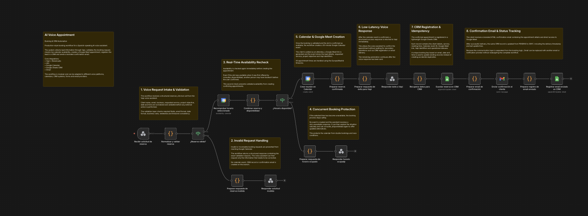
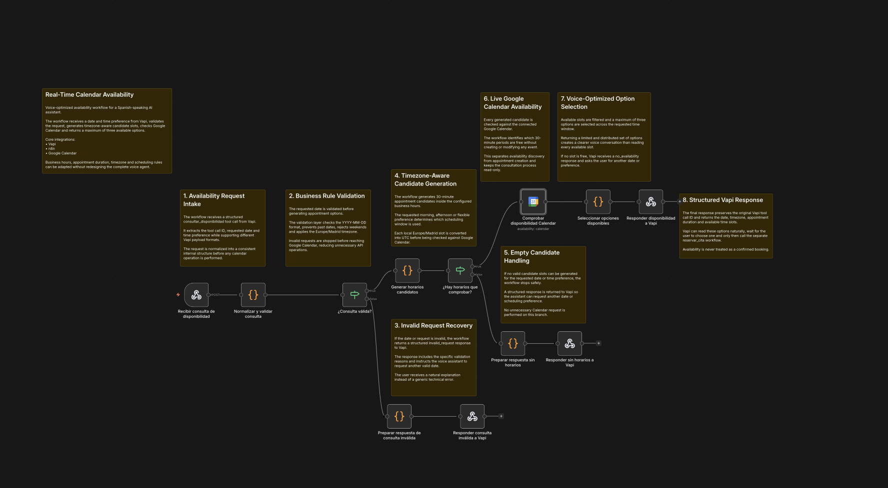
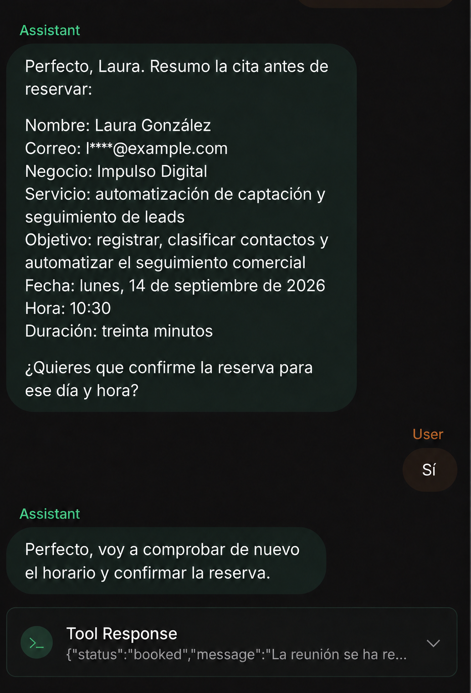
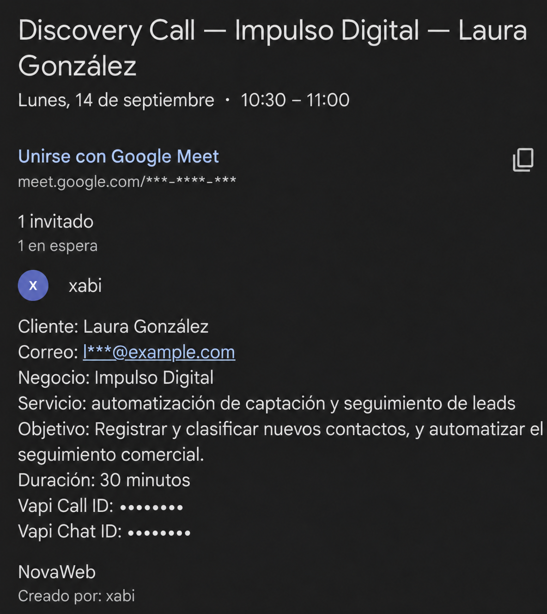
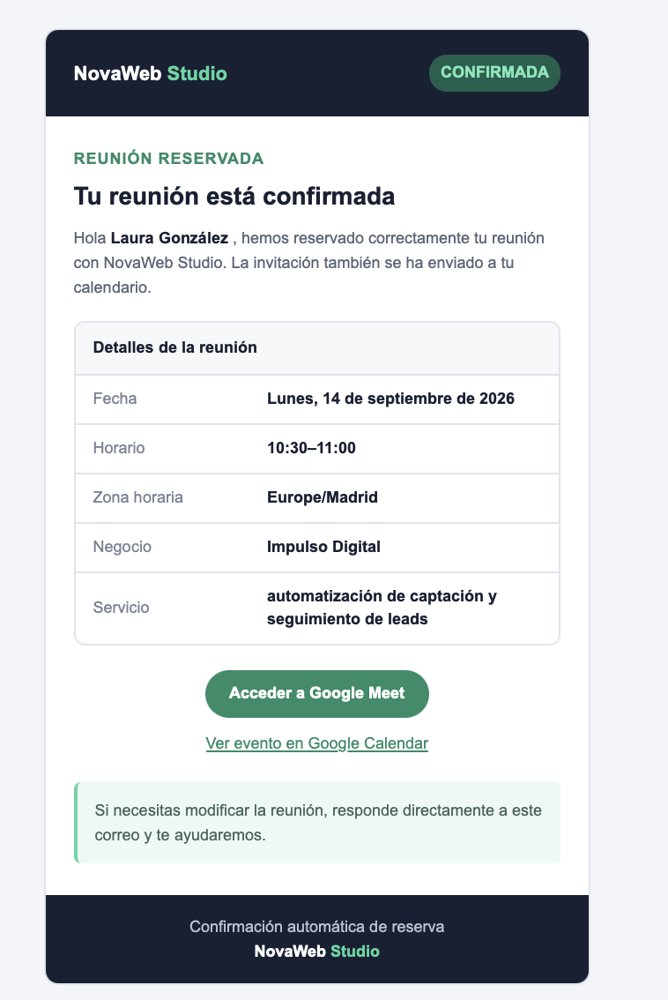

# AI Voice Appointment Booking & CRM Automation

A Spanish-speaking voice agent that qualifies leads, checks live Google Calendar availability, reduces stale-slot booking risk through a final availability recheck, creates Google Meet appointments, updates a lightweight CRM, and sends branded confirmation emails.

This is an independent portfolio project built and tested with fictional business data. It is not presented as a client deployment, and no unverified time or revenue savings are claimed.

## What the system does

1. Collects the requested service, project objective, contact details, date, and preferred time window through Vapi.
2. Validates the request before calling external services.
3. Generates 30-minute candidates in the `Europe/Madrid` timezone.
4. Checks each candidate against Google Calendar and returns up to three available options.
5. Waits for explicit user confirmation.
6. Rechecks the selected slot immediately before booking.
7. Creates the Calendar event and Google Meet link only if the slot remains free.
8. Responds to the voice agent with a structured result.
9. Upserts the booking into Google Sheets and records email-delivery status.
10. Sends a branded confirmation email to the attendee.

## Reliability decisions

- **Read-only discovery:** checking availability cannot create an event.
- **Explicit confirmation:** the booking tool is called only after the user approves the summary.
- **Final availability recheck:** the selected slot is checked again before any side effect, reducing the risk of booking a slot that became occupied during the conversation.
- **Early validation:** invalid dates, weekends, malformed emails, and unsupported time windows stop before Calendar, CRM, or Gmail.
- **Timezone-aware conversion:** local appointment times are converted to UTC for Calendar operations.
- **Idempotent CRM writes:** a deterministic booking key updates the matching record instead of appending duplicates.
- **Low voice latency:** Vapi receives the booking result after Calendar confirms the event; CRM and email processing continue afterward.
- **Traceability:** Calendar IDs, Meet links, Vapi IDs, booking status, and email status are recorded.

## Architecture

The project is split into two n8n workflows:

- [`check-calendar-availability.public.json`](workflows/check-calendar-availability.public.json) validates the date and time preference, generates candidates, checks Calendar, and returns voice-ready options.
- [`book-appointment.public.json`](workflows/book-appointment.public.json) validates the complete booking, rechecks availability, creates the event and Meet link, updates the CRM, and sends the confirmation email.

The [`vapi/`](vapi/) directory includes the sanitized assistant configuration, its complete Spanish system prompt, and both Function tool definitions. Private tool IDs, voice IDs, and n8n production webhook URLs have been replaced with placeholders.

## Tested paths

- Valid request and free slot: appointment booked successfully.
- Invalid request: rejected before any external side effect.
- Slot occupied after being offered: the final recheck prevented a double booking.

## Evidence

| Voice confirmation | Calendar result | Email result |
| --- | --- | --- |
|  |  |  |

The screenshots contain fictional business data. Private identifiers, personal email addresses, webhook paths, credential IDs, Calendar IDs, and spreadsheet IDs are excluded from this repository.

## Stack

- Vapi
- ElevenLabs
- n8n
- JavaScript
- Google Calendar and Google Meet
- Google Sheets
- Gmail

## Run the project

See [`SETUP.md`](SETUP.md). The public workflow exports are intentionally inactive and contain placeholders for external resources. After import, connect your own n8n credentials and select your own Calendar and spreadsheet.

## Production considerations

This repository demonstrates the complete integration flow, but a production deployment should additionally authenticate incoming webhooks, apply rate limits and operational monitoring, and use a lock or transactional reservation mechanism when strict protection against simultaneous bookings is required. The final Calendar recheck mitigates stale availability; it is not an atomic lock.

## Case study

The complete visual case study is available in [`docs/case-study.pdf`](docs/case-study.pdf).

## Privacy and scope

The repository contains sanitized exports intended for technical review. It does not include API keys, OAuth credentials, private webhook URLs, real client data, or the original private screenshots.

